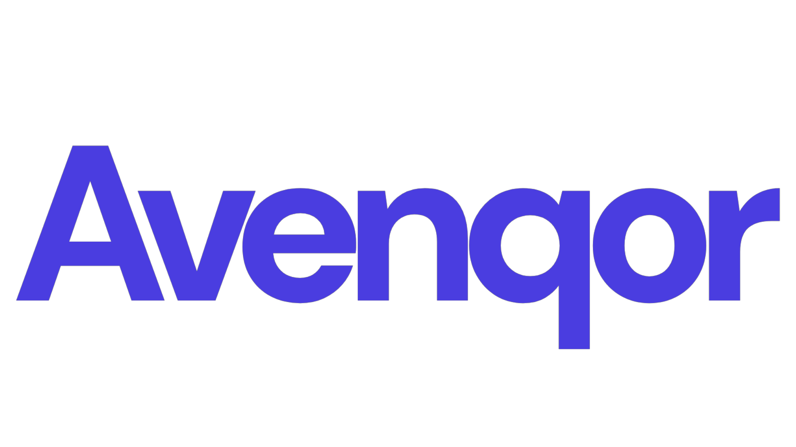
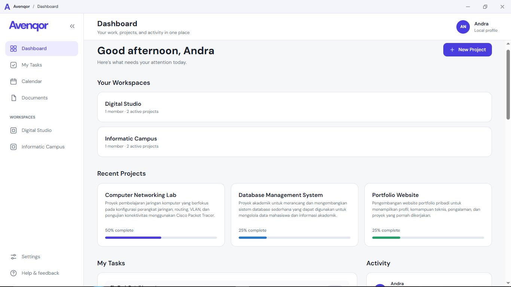
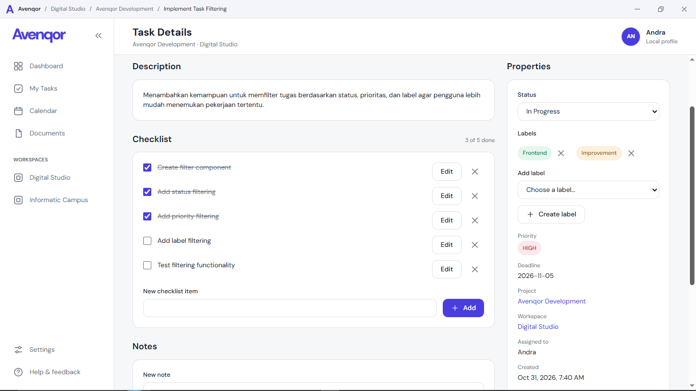
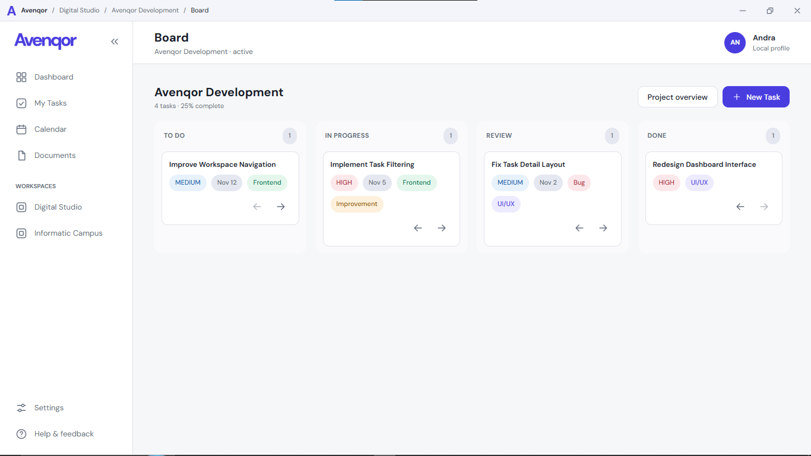
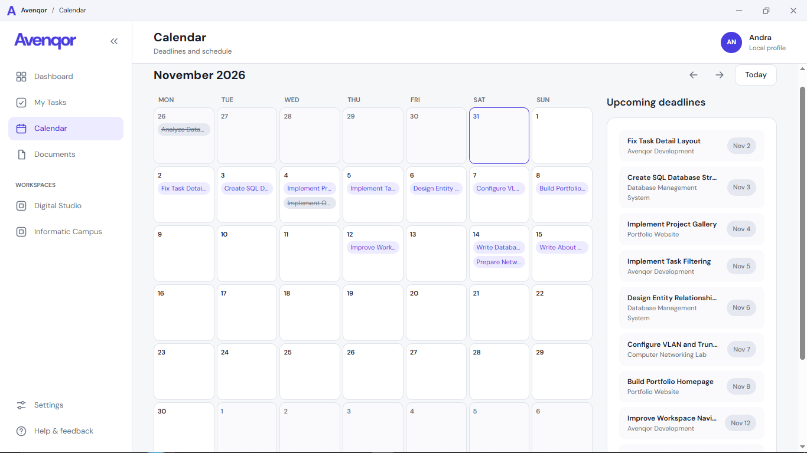
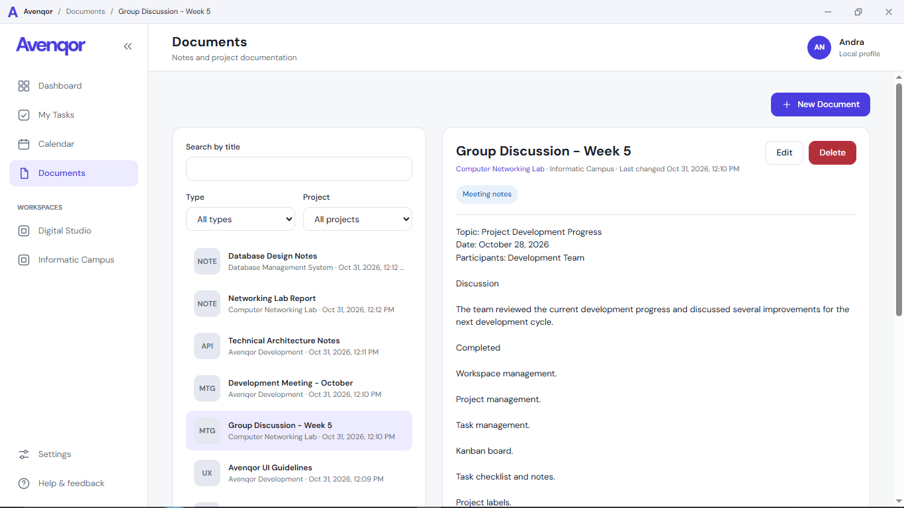
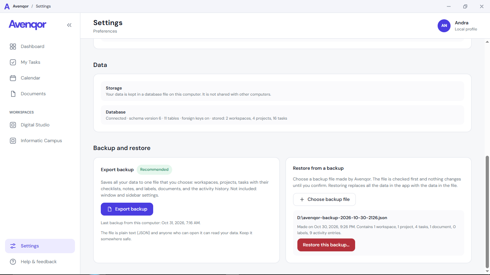

<div align="center">



# Avenqor

**A local-first project manager for Windows.**
Organize workspaces, projects, tasks, deadlines, and documents in one place, on your own computer, with no account and no internet.


</div>

<p align="center">
  
</p>

> **Status: pre-1.0 (version 0.1.0).** Avenqor is under active development and has no public release yet. The work lives on the branch `phase-3-kanban`; `main` still holds the starting template and will be updated when the developer merges. Everything described below as "works" has been tested by the developer on Windows 10; see [docs/DEVELOPMENT_STATUS.md](docs/DEVELOPMENT_STATUS.md) for the dated test log.

## Contents

- [What is Avenqor?](#what-is-avenqor)
- [Features](#features)
- [Your data stays with you](#your-data-stays-with-you)
- [For programmers](#for-programmers)
- [Getting started](#getting-started)
- [Roadmap](#roadmap)
- [Documentation](#documentation)

## What is Avenqor?

Avenqor is a desktop app for people who juggle several pieces of work at once: university students with group assignments, programming students and small dev teams, independent developers, and content creators with production workflows.

Work is organized in three levels:

```
Workspace  →  Project  →  Tasks (and their checklists, notes, labels, documents)
```

For example, the workspace **Informatics Group** can hold the projects **Final Semester Project** and **Portfolio Website**. Each project has its own board, tasks, deadlines, documents, and activity.

Avenqor works **fully offline**. Nothing is sent anywhere, and no account is needed. It is a single-user app today: data on one computer is not shared with other computers, and the app does not pretend otherwise.

## Features

Every item below is implemented and has been tested by the developer.

### Dashboard and workspaces

See your workspaces, recent projects, the tasks assigned to you, and recent activity at a glance. Create, rename, and delete workspaces; each shows its projects and activity.

### Projects and tasks

Create, edit, archive, restore, and delete projects. Tasks have a title, description, status, priority, and deadline. Project **progress is calculated** from the tasks in Done, never typed in. Each task page also has:

<p align="center">
  
</p>

- a **checklist** (add, tick, edit, remove),
- **notes** (newest first, editable),
- **labels** with colors, defined per project.

### Kanban board

Four columns: To Do, In Progress, Review, Done. **Drag a card** to another column, or use the arrow buttons. Priorities, deadlines, and labels show on each card, and every move is saved right away.

<p align="center">
  
</p>

### Calendar, deadlines, and My Tasks

A month calendar shows task deadlines, with overdue ones in red. An upcoming-deadline list sits next to it. **My Tasks** lists everything assigned to you across all active projects, with a status filter.

<p align="center">
  
</p>

### Project documents

Keep notes, requirements, meeting notes, API references, and UI/UX decisions next to the work. Documents are plain text, searchable by title, and can be filtered by type and project.

<p align="center">
  
</p>

### Activity history

Important changes (creating, editing, moving, archiving, deleting) are recorded locally and shown on the Dashboard, the workspace page, and the project page.

### Backup and restore

Export all your data to one readable JSON file, and restore it later. A restore **replaces everything**, so Avenqor first requires you to save a safety backup of your current data, and it checks the file completely before it changes anything. A file that is damaged or not made by Avenqor is refused with a clear message.

<p align="center">
  
</p>

### Interface

Clean light theme, DM Sans font, indigo accent, a collapsible sidebar, and a custom title bar that shows where you are (for example *Workspace / Project / Board*). The window works down to 960x600.

## Your data stays with you

- All data is stored in one SQLite file, `avenqor.db`, in `%APPDATA%\io.github.andra-gs.avenqor` on Windows. It is **not** in the installation folder, so uninstalling or updating the program does not touch it.
- Avenqor makes no network requests for its features. (The first *build* from source downloads packaging tools; running the app does not.)
- A backup file contains your workspaces, projects, tasks, checklists, notes, labels, documents, and activity history. It does not contain program settings, because there are none yet, and it is not encrypted: store it somewhere you trust.

## For programmers

### Stack

| Layer | Choice |
|---|---|
| Desktop shell | [Tauri 2](https://tauri.app) (Rust) with Microsoft Edge WebView2 |
| Interface | React 19, TypeScript, Vite, React Router (hash routing) |
| Styling | Tailwind CSS 4, with all colors, sizes, and radii defined once as design tokens |
| Database | SQLite through the official Tauri SQL plugin, with numbered migrations |
| Files | Tauri dialog and fs plugins, used only for backups |

### Architecture in one picture

```
Page  →  Feature (sections)  →  Hook  →  Service  →  Repository  →  SQLite
                                          rules,       only SQL
                                          validation
```

- **Pages compose, hooks fetch.** A page arranges sections; data comes from hooks. Components never touch the database.
- **Services** hold the business rules (validation, UUIDs, progress). **Repositories** are the only code that writes SQL, always with parameters.
- **Base components** (`src/components/ui`) accept no `className`, so the look of the app can only change in one component or in `src/styles/tokens.css`. Changing the accent color in that single file recolors every screen.
- **Activity history is written by SQLite triggers**, not by app code, so a change and its history entry are saved atomically.
- **Restore is one SQL script** (`BEGIN IMMEDIATE … COMMIT`) sent in one call, because the SQL plugin may use a different connection per call. Backup files are treated as untrusted input.
- **Least privilege:** the permission file lists only what the app needs, and the frontend can reach only files the person picks in the system file windows.

Data conventions: UUID text IDs, deadlines as `YYYY-MM-DD`, timestamps as UTC ISO 8601, and no stored progress. The database has 11 tables (schema version 6): profiles, workspaces, workspace members, projects, tasks, checklist items, notes, labels, task labels, documents, and the activity log. Workspace members and the local profile are already in place so that roles (owner, admin, member, guest) can be supported when collaboration arrives.

Details: [docs/ARCHITECTURE.md](docs/ARCHITECTURE.md) and [docs/DATABASE_SCHEMA.md](docs/DATABASE_SCHEMA.md).

### Project layout

```
src/
  app/ assets/ components/ features/ pages/ hooks/ services/ repositories/ lib/ styles/ types/
src-tauri/
  src/            Rust entry point and plugin registration
  migrations/     numbered SQL migrations (never edited after release)
  capabilities/   Tauri permissions
docs/             documentation
```

## Getting started

Avenqor is not released yet, so for now you run it from source.

### Prerequisites (Windows)

From the [Tauri prerequisites](https://v2.tauri.app/start/prerequisites/):

1. **Microsoft C++ Build Tools** with the **"Desktop development with C++"** workload (installing the Build Tools alone is not enough; use Visual Studio Installer, Modify).
2. **Microsoft Edge WebView2** (already part of Windows 10 1803+ and Windows 11).
3. **Rust**, installed with `rustup`, using the MSVC toolchain (`rustup default stable-msvc`). The SQL plugin needs Rust 1.90 or newer.
4. **Node.js** LTS with npm.

Check what you have in PowerShell:

```powershell
node -v
npm -v
rustc --version
cargo --version
rustup show
```

If `npm` says "running scripts is disabled on this system", run this once and try again:

```powershell
Set-ExecutionPolicy -Scope CurrentUser -ExecutionPolicy RemoteSigned
```

### Run in development

```powershell
git clone https://github.com/andra-gs/project-manager.git
cd project-manager
git checkout phase-3-kanban
npm install
npm run tauri dev
```

The first run compiles all Rust dependencies (about 18 minutes on the developer's computer); later runs are faster. Close the window and press `Ctrl+C` to stop.

### Build a Windows release

```powershell
npm run tauri build
```

The first build took about 34 minutes and downloads the WiX and NSIS packaging tools from GitHub. Output is in `src-tauri\target\release\`: the program `project-manager.exe`, an MSI installer in `bundle\msi\`, and an NSIS installer in `bundle\nsis\`. The installers have been built but not yet installed and tested; that is a 1.0 task.

### Useful commands

| Command | What it does |
|---|---|
| `npm run tauri dev` | Starts the desktop app with live reload |
| `npm run build` | Type-checks (`tsc`) and builds the frontend; must pass before every commit |
| `npm run tauri build` | Builds the release program and installers |

There is no automated test suite yet. Features are tested by hand and the results are logged with dates in [docs/DEVELOPMENT_STATUS.md](docs/DEVELOPMENT_STATUS.md).

## Roadmap

| Phase | Goal | State |
|---|---|---|
| 0 | Environment and project setup | Done |
| 1 | Interface foundation | Done |
| 2 | SQLite, workspaces, projects, tasks | Done |
| 3 | Board, calendar, task details, documents, activity | Done |
| 4 | Backup and restore, search and filters, validation review, local notifications | In progress (backup and restore done) |
| 5 | GitHub integration | Future |
| 6 | Online accounts, sync, shared workspaces | Future |
| 7 | Web, Android, iOS, and AI assistance | Future |

**Version 1.0** means Phase 4 plus release preparation: a tested installer, a decision on where the database folder lives, a trademark check of the name, and a custom installer look. After 1.0, the plan is to choose between a mobile version and a bigger update: documents as files and folders, and a whiteboard for each workspace (details in [docs/PROJECT_OVERVIEW.md](docs/PROJECT_OVERVIEW.md)). GitHub and online features are later phases and are **not** part of 1.0.

Known limitations today: no subtasks, no search across everything yet, no reminders or notifications yet, no templates, and single-user only. The database folder is in Roaming (see Known issues in the status file).

## Documentation

| File | What it covers |
|---|---|
| [CLAUDE.md](CLAUDE.md) | Project instructions and development rules |
| [docs/PROJECT_OVERVIEW.md](docs/PROJECT_OVERVIEW.md) | Goals, target users, MVP scope, roadmap, future plans |
| [docs/ARCHITECTURE.md](docs/ARCHITECTURE.md) | How the application is structured, and why |
| [docs/DATABASE_SCHEMA.md](docs/DATABASE_SCHEMA.md) | SQLite tables and migrations |
| [docs/DEVELOPMENT_STATUS.md](docs/DEVELOPMENT_STATUS.md) | What is done, tested, broken, and next |
| [docs/BRAND.md](docs/BRAND.md) | Brand identity notes (in Indonesian) |

## About

Avenqor is built by [Andra](https://github.com/andra-gs) as a learning project, together with Claude (Anthropic) as an AI development partner. The product name is Agreed; a trademark check has not been done yet. No license has been chosen yet, so all rights are reserved until one is added.
